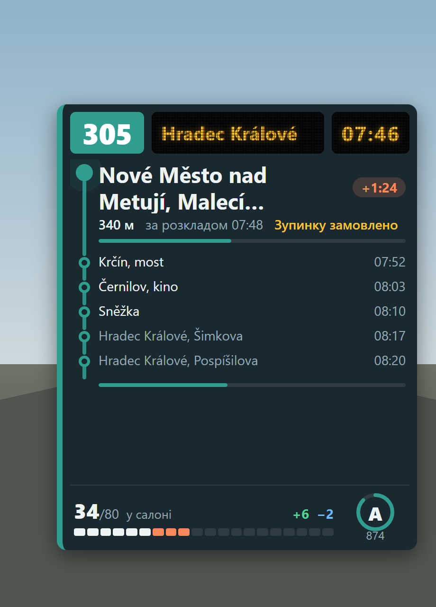

# Earth Bus Routes

An add-on for [BeamNG.Earth](https://github.com/TecnaGamer/BeamNG.Earth): drive real bus routes from OpenStreetMap anywhere on
Earth. Pick the nearest stop, choose a line and a direction, set the departure time, carry passengers whose numbers follow the
time of day, keep to a generated timetable and get scored at the end. Then drive back, or take another line from the same place.



## What you get

- **Stops near you**: the bus stops and stations within 600 m, with the lines that call at each.
- **Real timetables (Czechia)**: every bus line of the country from the state's timetable register, with its real departures
  and the time at every stop, also the lines OpenStreetMap lacks. Elsewhere the timetable is generated.
- **Map, towns, stations and stops**: a map tab with a chip for every town round you and the stations and stops as chips and
  dots; a town brings the map closer with all its stops; a stop gives you the GPS route there, a teleport or its lines. The
  route builder can add a town's main station with one click.
- **Stop markers** in the world at the next stops, and a progress bar for everything slow.
- **Search**: type a station name or a line number (363, N1); results appear as you type from the data service's own index, and the public servers fill in the rest.
- **Lines from, to and through a station**: three tabs; a line that ends at the station you stand at can be driven from its start: teleport there, or drive there with the GPS and the trip begins when you arrive.
- **Lines and directions**: every line with its operator, network, length, ride time, stops and how often it runs through the day.
- **Start where you want**: from the stop you stand at, or from the line's first stop; choose the departure time and the game
  clock jumps to it. The timetable is generated (OpenStreetMap almost never says how often a bus runs): city, regional and
  night lines, rush hours, weekends. `interval`, `duration` and `opening_hours` tags win when a line has them.
- **Passengers**: how many wait at a stop depends on the time of day, the stop, the weather and how late you are. They board
  and leave only while your doors are open.
- **HUD**: line, destination blind, next stop with distance, delay and requested stop, the stops after it, passengers on board,
  score. The stock bus destination sign shows your line too.
- **Score and the way back**: punctuality, service, comfort and safety, a grade, your best on the line. After the last stop:
  drive the line back, or pick another line from there.

- **Your own routes** (manual mode): when OpenStreetMap has no line for where you want to go, build one. Pick the stations one
  after another (bus stations first, a search by name reaches 40 km), watch the road between them being found, decide whether
  the bus calls at every stop on the way or only at your stations, give it a number and a colour, save it. Then it is a
  line like any other: timetable, passengers, HUD, score, the way back. You can also continue an incomplete OpenStreetMap line
  as your own, and after a trip build the next leg from where it ended.

English and Ukrainian; the menu follows the game language and has a switch.

## Install

1. In BeamNG.Earth (1.9.0 or newer): Esc > BeamNG.Earth > Add-ons > Add from GitHub > `Robitnik/earth-bus-routes`.
2. Add `Robitnik/earth-bus-routes-data` the same way, press **Start** and turn on **Starts with BeamNG.Earth**. This is a small program
   that fetches routes from OpenStreetMap for the mod: the game's Lua sandbox only lets a mod talk to this computer, so it cannot ask
   the internet itself.
3. In a bus (other vehicles work too but score half): **Ctrl+Shift+B**, or the pause menu > Mods > Bus routes.

The first visit to a place fetches its data from a public OpenStreetMap server, which can take up to a minute when that server is
busy. Everything is kept on disk, so the next time it is instant.

The data service also downloads, once, the towns of the countries round you (GeoNames, a few MB) and, when you play in Czechia,
the national bus timetables (about 124 MB, refreshed weekly, kept as a 65 MB index); the progress line in the menu shows it.
To go without the timetables, start the service with the environment variable `BNE_BUSDATA_GTFS=0`.

## How it is built

```
mod/                    the game mod (the zip's contents)
  lua/ge/extensions/earthBusRoutes/   osm, schedule, demand, scoring, trip, menu, builder (pure logic, tested) +
                                      datasvc, http, world, main (talk to the game and the service)
  ui/ui-vue/mods/earthBusRoutes/      the menu (Vue)
  ui/modules/apps/EarthBusHud/        the HUD (Vue)
companion/bus_routes_data.py          the data service (stdlib Python, listens on 127.0.0.1 only)
tests/                                Lua tests under lupa, Python tests for the service, recorded Overpass answers
tools/                                build, dev loader, preview with screenshots
docs/                                 research and plans
```

The manual mode needs data service 0.2.0 or newer (roads from OSRM, stops along them, search); an older service still lets you
build with straight lines between the stations.

Requires BeamNG.Earth's modding API v1 (`beamngEarth_api`). The mod only calls the Earth internals it needs through `pcall`
(`world.lua`), so a change in Earth turns a feature off instead of breaking the game.

## Development

```
PY=D:/Projects/BeamNG.Earth-dev/.venv/Scripts/python.exe
$PY tools/run_tests.py                                   # Lua tests under lupa
$PY -I -m unittest discover -s tests -p "test_companion.py"   # the data service
$PY tools/build_zip.py                                   # dist/earth_bus_routes.zip
$PY tools/dev_push.py                                    # working copy into a running game (then tools/dev_loader.lua over MCP)
cd tools/preview && npm install && node shoot.mjs hud approach atstop && node shoot.mjs menu nearby route result
```

`tools/preview` renders the real `.vue` files in a browser with stand-ins for the game's modules, for screenshots in `docs/shots`.

Map data (c) OpenStreetMap contributors (ODbL). MIT licence.
